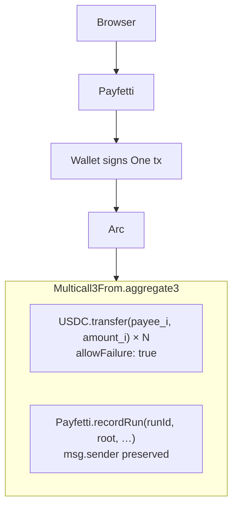
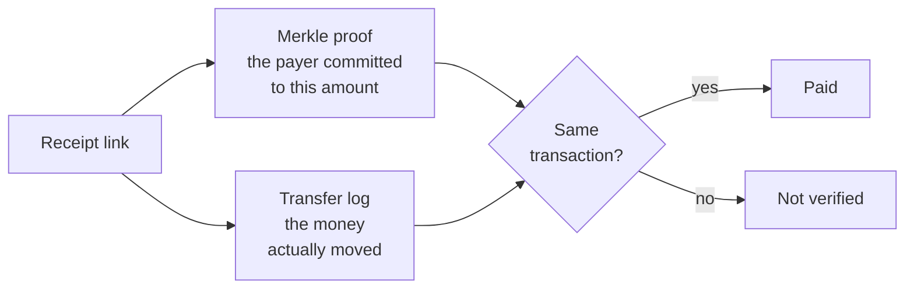

<p align="center">
  
</p>

<h1 align="center">Payfetti</h1>

> Pay hundreds of people tiny amounts in one transaction, for pennies,
> each with a receipt they can verify.

Built on [Arc](https://docs.arc.io), Circle's stablecoin L1, where USDC is the native
gas token. Built for [Arc Microgrants](https://dorahacks.io/hackathon/arc-microgrants).

**Live on Arc mainnet:** [`0x7dACb26F…04f835`](https://explorer.arc.io/address/0x7dACb26F14af8E844dABBB2DBA1D31427204f835),
deployed in [`0x9b53a395…`](https://explorer.arc.io/tx/0x9b53a395c46b52af39617baccee9ea7291a9a0bfdcd9db4459f63ad109d2a03e)
for $0.0121, with its source published on the explorer. The same bytecode runs on
[Arc testnet](https://explorer.testnet.arc.io/address/0x7dacb26f14af8e844dabbb2dba1d31427204f835)
at the same address, byte for byte.

## The problem

Say you are paying 200 survey respondents a dollar each. Or sending $2 to every
moderator who cleared a queue this week. Or splitting a $500 bounty pool across forty
contributors. Or paying research participants on the day they finish rather than in
one batch at the end of the quarter.

| How you'd pay them today | Fee each   | On a $200 payout                      |
| ------------------------ | ---------- | ------------------------------------- |
| PayPal / card            | $0.30–0.50 | $60–100 in fees                       |
| ACH                      | ~$0.25     | ~$50, plus 200 manual entries         |
| International wire       | $10–15     | $2,000–3,000. Structurally impossible |
| Gift cards               | "free"     | What people actually do               |

Every incumbent rail has a per-payment floor of roughly $0.25 to $15. Below about $2
the fee eats the payment, so the payment usually doesn't happen at all. The study gets
cancelled, or 200 × $1 becomes one $200 raffle.

That floor isn't a tax, it's a hiring filter. If paying someone $2 costs $12, you
don't pay them $2 and grumble. You never make the offer.

## What it does

Paste a list, check the preview, sign once. Everyone is paid in a single transaction,
and each person gets a link that proves their own payment.

| | |
|---|---|
| **Validation before anything moves** | checksums, duplicates, zero addresses, amounts that cannot be sent exactly, and your balance against the total |
| **The cost, before you sign** | quoted in dollars from a live gas estimate |
| **One transaction** | no `approve` step, no per-payee signatures, no custody |
| **Per-payee outcome** | paid or skipped, each with an explorer link |
| **A receipt for every payee** | a URL that re-checks itself against the chain, with no account and no trust in us |
| **Optional on-chain notes** | the reason for a payment outlives the link, and recipients can find themselves |
| **An exportable run file** | every receipt and proof in one JSON, which is the durable copy |
| **Retry only the failures** | skipped payees are recorded on-chain and re-run as their own batch |

Every function in the contract has been executed on Arc mainnet.

## Why Arc

| Rail               | Per-payment floor |
| ------------------ | ----------------- |
| International wire | $10–15            |
| Card / PayPal      | $0.30–0.50        |
| ACH                | ~$0.25            |
| **Arc**            | **$0.00093**      |

The Arc figure is measured. The other three are published list prices checked October
2026, and two of them are deliberately generous to the incumbent: card counts only the
fixed component, and wire sits well below the $25–50 US banks commonly publish.
Provenance and caveats: [`docs/gas.md`](docs/gas.md).

200 payees in one `aggregate3` costs 9,425,620 gas, about **$0.189**. Each extra payee
adds 46,459 gas, about **$0.00093**, and that figure falls as batch size grows and the
fixed overhead amortises. One run fits roughly 642 payees inside Arc's 30M gas block.

If you would like to check that against live Arc, this is read-only and needs no
wallet:

```bash
python3 scripts/measure-gas.py
```

| Payees | On Arc                               | Same payout via PayPal |
| ------ | ------------------------------------ | ---------------------- |
| 50     | **$0.058** (executed, not estimated) | $15–25                 |
| 200    | **$0.189**                           | $60–100                |
| 500    | **$0.467**                           | $150–250               |

Three Arc-specific properties make this a product rather than a script:

- **`Multicall3From` and the `CallFrom` precompile.** N transfers in one transaction,
  no `approve` step, and `msg.sender` survives, so there is no custody and no
  signature plumbing.
- **The `Memo` predeploy, nested inside that batch.** Each payment carries its own
  reason on-chain for 9,299 gas, about **$0.000186**. Circle documents the two
  contracts separately and never states that one works inside the other, so we
  measured it rather than assumed it: [`docs/memo.md`](docs/memo.md).
- **Sub-second deterministic finality.** The UI can say "paid" and mean it.

On Ethereum this is arithmetically impossible: 200 transfers would cost more than the
$200 payout.

## How it works



`Multicall3From` only accepts calls from an EOA, so the Payfetti contract rides
*inside* the batch rather than wrapping it. Because `CallFrom` preserves the sender,
`recordRun` sees the payer as `msg.sender` and the record is self-authenticating.

`allowFailure: true` is mandatory. Arc enforces USDC blocklists at the protocol level,
so a transfer to a screened address reverts, and without per-call isolation one bad
address would kill a 200-payee run.

### On-chain notes

With notes enabled, each transfer is wrapped in Arc's `Memo` predeploy inside the same
batch:

```
Memo.memo(USDC, transfer(payee_i, amount_i), runId, note_i)
```

The note is published permanently, bound to that exact transfer, and tagged with the
run's id so a whole run's notes come back in one call. It costs **+20% gas**, about
3.7 cents on a 200-payee run, and it is a per-run choice. With notes off they live
only in the receipt links.

Looking up a run you can name is cheap. Finding out *which* runs were yours is not:
Arc's public RPC refuses wide `getLogs` ranges, so the app reads the explorer's
transaction list for that and re-checks every result against the chain before showing
it. The exported run file is the copy you keep.
[`docs/architecture.md`](docs/architecture.md) has the reasoning.

The nesting result and its cost are reproducible, read-only:

```bash
python3 scripts/probe-memo.py
```

Two of its six cases are controls that must *fail*. `eth_call` sets `tx.origin` to
whatever caller you name, so it cannot tell an EOA from a contract, and an earlier
version of this probe drew a false conclusion from exactly that. The controls that do
bite ask the precompile to act for a non-origin address, and to act for an EOA calling
it directly. Both are refused, which is how we know its access control is enforced
here at all.

## Verified on-chain

**50 people paid on Arc mainnet in one transaction, with a note each, for 5.8 cents.**
[`0x3ba827ef…`](https://explorer.arc.io/tx/0x3ba827ef46bfe64725af0bb1ed956f67989861b654d1cb507ce738d3bbde985f),
52 subcalls, 26,628 bytes of calldata, 2,900,002 gas, 9.7% of a block.

Real USDC. 50 paid and proven, 1 skipped, no problems. Amounts ran 0.000001 to
0.000050 so every Merkle leaf differs, and the payees are unspendable by anyone,
derived as `keccak256(label ‖ index)` so no private key exists for them. The money
provably left and did not come back to us.

At the event level, decoded from the receipt:

| | |
|---|---|
| USDC `Transfer` logs | **50** |
| `Memo` events | **50**, aligned, with **no orphaned note** for the failed row |
| notes bound to the right payee by `callDataHash` | **50 / 50** |
| node estimate vs actual | 2,924,185 vs 2,900,002, **0.8% high** |

```bash
python3 scripts/verify-run.py \
  --tx 0x3ba827ef46bfe64725af0bb1ed956f67989861b654d1cb507ce738d3bbde985f \
  --proofs fixtures/batch-51-mainnet-proofs.json
```

### Earlier runs on testnet

Two rehearsals, checked by the same verifier without modification. That is the point:
a receipt verifies identically whether notes went on-chain or not.

| Run | Result | Cost | Proofs |
|---|---|---|---|
| [50 payees](https://explorer.testnet.arc.io/tx/0x9ef59d48708e03aff07a5491ccc4f3996c752f1202abd37eba359850e7f28a79) | 49 paid, 1 skipped | $0.0477 | `fixtures/batch-50-proofs.json` |
| [9 payees, with notes](https://explorer.testnet.arc.io/tx/0x152d39bebed27babe795bdf1132a90292029e0c3e3e78e0d10ec7e469c214bfe) | 8 paid, 1 skipped | $0.0116 | `fixtures/batch-9-memo-proofs.json` |

Resubmitting either batch reverts with `RunAlreadyRecorded` before any transfer
re-executes, so a resubmitted batch cannot double-pay. Both skipped rows were bad
addresses added on purpose, and neither left an orphaned note behind.

You can rehearse a run of your own the same way, with free USDC from
[faucet.circle.com](https://faucet.circle.com), by pointing the app at testnet.

### What the contract is for

Moving the money is the easy part. The contract does three things:

| Job                                               | Why                                                            |
| ------------------------------------------------- | -------------------------------------------------------------- |
| Rejects a duplicate `runId`                       | a double-click or a retry cannot double-pay                    |
| Stores a Merkle root over `(payee, amount, note)` | each payee gets a receipt proving *they* were paid this amount |
| Records skipped payees                            | re-run only the failures, not the whole batch                  |

It holds no USDC and has no function that could move any. There is no owner, no admin
and no upgrade path. A bug in it could produce a wrong record, but it could not take
anyone's money, because it never has any.
See [`docs/security.md`](docs/security.md).

### What a receipt proves

A payee's link checks two things against the chain, and needs both.



The proof alone would only show a payment was *declared*. The transfer log alone would
have no committed amount to check against. Both sit in the same transaction, so
neither can be forged without the other.

The record stores its own block number, so looking a receipt up is a direct read
rather than a search. No backend, no indexer, nothing to keep running.

## Stack

Solidity 0.8.24, Foundry, React 18 + TypeScript + Vite, wagmi + viem, MDX.

The verifier scripts are dependency-free Python, including a Keccak-256
implementation written from scratch, so a reviewer can check every claim with nothing
but `python3` and `curl`.

## Build and test

```bash
git submodule update --init --recursive
cd contracts && forge test -vv
```

```bash
cd web && npm ci && npm test && npm run dev
```

Needs Foundry 1.8 or newer, and the Node version pinned in `.nvmrc`.

## Layout

```
contracts/
  src/Payfetti.sol      the run registry: no token logic, no owner, no upgrade path
  test/Payfetti.t.sol   20 tests, including 3 fuzz properties
  script/Deploy.s.sol   deploy to arc / arc_testnet
web/                    React frontend: create a run, verify a receipt
docs/
  security.md           threat model, including what a receipt does not prove
  gas.md                every cost figure, measured
  memo.md               on-chain notes: the undocumented nesting, and its cost
  architecture.md       why there is no backend or database
  arc-notes.md          two Arc gotchas that cost us a day
scripts/                read-only verifiers for the claims above
fixtures/               Merkle proofs for every run cited here
```

## Honest limits

- **Payees need a wallet address.** That is the real ceiling on reach. Email claim
  links, passkey wallets and local cash-out would widen it, and none are built yet.
- **The payer must be an externally owned account.** Arc's `CallFrom` precompile
  accepts nothing else, so Safe and ERC-4337 wallets cannot pay through Payfetti,
  which rules out multisig treasuries. Measured, not inferred:
  [`docs/memo.md`](docs/memo.md).
- **On-chain notes are public forever.** They default to on because our market writes
  things like "participant 001". Turn them off for anything that identifies a person,
  since nothing filters what a payer types.
- **There is no fee today.** Compliance and reporting features, the things that make a
  payout rail defensible at scale, will be added over time. Arc's protocol-level USDC
  blocklists apply regardless.
- Payfetti doesn't create work. It makes paying for work that already exists possible,
  which is one layer below a marketplace.

## Contributing

Payfetti leaves plenty of surface worth building on, and pull requests are genuinely
welcome. Bug fixes, refactors, sharper error messages and tests that widen coverage
are all valuable contributions here.

Two things worth knowing first.

**The Merkle tree exists three times**, in `contracts/src/Payfetti.sol`,
`web/src/lib/merkle.ts` and `scripts/keccak.py`, and all three have to agree byte for
byte. When they drift, every receipt silently returns false with nothing to debug.
`web/tests/merkle.test.ts` pins them against values the deployed contract has already
accepted, so please run it if you touch any of the three.

**Security issues do not belong in a pull request.**
[`SECURITY.md`](SECURITY.md) sets out how to report one.

Beyond the commands in [Build and test](#build-and-test), CI also runs
`forge fmt --check`, `npm run typecheck` and `npm run build`. A green run is all a
pull request needs. [`AGENTS.md`](AGENTS.md) carries the invariants and the house
style for comments and commit messages.

## Disclosure

Built with AI assistance, disclosed per Arc Microgrants submission requirements.

## License

MIT
